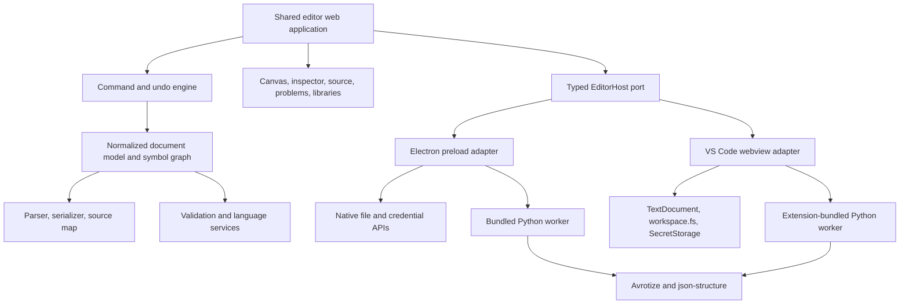

# JSON Structure Editor: Product and Engineering Plan

Status: prototype-informed proposal
Location: `sdk/editor`
Targets: Windows, macOS, Linux, and the existing VS Code extension

The plan incorporates the interaction and scale findings demonstrated in `visual-concept.html` and `graph-navigation-prototype.html`. Those files are disposable design prototypes, not production dependencies; their validated behaviors and constraints are normative here.

## 1. Decision summary

Build one editor experience as a shared browser application with two thin hosts:

- an Electron desktop application, packaged with Electron Forge;
- a VS Code `CustomTextEditorProvider` contributed by `sdk/vscode`;
- Monaco for the source editor in the Electron host;
- a normalized JSON Structure model and command engine shared by both hosts;
- one projection and interaction engine for Design, Graph, Source, and inspector selections;
- the VS Code `TextDocument` as the authoritative text buffer in the extension host;
- a bundled, pinned Python runtime and Avrotize worker for conversion in the desktop distribution;
- the same worker protocol in VS Code, with the runtime supplied by the extension package rather than by the user's machine.

Do not fork, embed, or rebrand Code-OSS. Monaco provides the required editing surface without taking on the extension host, workbench, update channel, branding, and upstream merge burden of a Code-OSS distribution.

## 2. Product principles

1. **One editor, two hosts.** Features, commands, key bindings, terminology, and document behavior are shared unless a host capability makes that impossible.
2. **Text remains canonical.** A JSON Structure document is always a UTF-8 JSON text document. The graphical view produces text edits; it does not create a second file format.
3. **Graphical commands preserve invariants.** The graphical editor does not commit a command that would produce an invalid model state. Disabled actions explain the violated invariant.
4. **Text editing remains unconstrained.** Monaco and VS Code permit incomplete or invalid JSON while typing. The graphical view enters a clear recovery state until a parseable model is available.
5. **No silent semantic changes.** Import expansion, type copying, renaming, add-in composition, conversion, and normalization always provide a preview when they can affect more than one declaration.
6. **Capability-driven language support.** Available fields and commands follow the active `$schema`, `$offers`, and `$uses`; extension keywords are not treated as globally valid.
7. **Fast keyboard paths.** Creating a type and entering many properties must be practical without leaving the keyboard.
8. **Portable and private by default.** Core editing and validation work offline. Telemetry is off unless explicitly enabled and never contains schema content, names, URIs, or conversion inputs.
9. **Overview and detail are simultaneous.** Semantic zoom changes representation density while breadcrumbs, minimap, selection, and history preserve orientation.
10. **Gestures are semantic contracts.** Click/tap selects, double activation opens or follows, drag pans, and wheel/pinch performs focal zoom. Editing always requires an explicit control or confirmed command.
11. **Catalogs suggest; documents decide.** Well-known units, currencies, and semantic terms are discoverable with provenance, but open vocabularies and custom values remain editable and round-trip exactly.

## 3. Non-goals

- Reimplementing the VS Code workbench or supporting arbitrary VS Code extensions.
- Becoming a general-purpose JSON IDE.
- Replacing source control, diff, merge, or terminal applications.
- Hiding lossy conversion. Conversion warnings and unsupported constructs are first-class output.
- Automatically publishing to registries or changing a registry's default version.
- Adding editor-only keywords to JSON Structure documents to persist UI state.

## 4. Users and core journeys

### 4.1 Schema author

1. Create or open a `.struct.json` document.
2. Choose a specification profile and enabled extensions.
3. Create types and properties graphically or in source.
4. Resolve diagnostics and inspect effective inherited/composed members.
5. Validate sample instances.
6. Export documentation, another schema format, or generated code.

### 4.2 Existing-schema adopter

1. Open Avro, JSON Schema, JTD, OpenAPI, CDDL, CUE, FlatBuffers, Thrift, Smithy, Cap'n Proto, RAML, JSON samples, or XML samples.
2. Review conversion options and warnings.
3. Preview the generated JSON Structure document.
4. Save it as `.struct.json` and continue in the same editor.

### 4.3 Library consumer

1. Add a local folder, static catalog document, or xRegistry endpoint.
2. Browse schema groups, schemas, versions, and types.
3. Import a document, import definitions, or copy selected types.
4. Resolve collisions and inspect provenance.
5. Re-resolve an import and compare its effective declarations with the previous cached snapshot, or compare explicitly copied local types with their recorded origins. Imports do not create schema-level reference links.

### 4.4 Registry publisher

1. Validate the document and inspect conversion/compatibility warnings.
2. Select a configured xRegistry destination.
3. Create a new immutable version.
4. Resolve optimistic-concurrency conflicts if the registry epoch changed.
5. Optionally request a separate operation to make the new version the default.

## 5. Architecture



### 5.1 Proposed package layout

```text
sdk/editor/
  PLAN.md
  visual-concept.html
  graph-navigation-prototype.html
  packages/
    model/                 normalized AST, symbols, capabilities, commands
    language-service/      parse, validation, completion, navigation
    registry/              library providers, cache, provenance, xRegistry
    catalogs/              unit, currency, and semantic catalog providers
    graph/                 projections, deterministic layout, hit testing, camera
    conversion-protocol/   worker messages and command metadata types
    ui/                    shared React application and design tokens
    electron/              main process, preload, Forge configuration
    python-worker/         launcher, lock file, smoke tests, packaging scripts
  tests/
    contracts/             adapter contract tests
    fixtures/              documents, imports, conversions, registries
    e2e-electron/
sdk/vscode/
  src/editorHost/          VS Code adapter and CustomTextEditorProvider
```

The package split is a target, not a requirement to create all packages on day one. Start with `model`, `ui`, and two adapters, then extract boundaries proven by tests.

### 5.2 The host port

The UI may call only a versioned, serializable interface. It must never import `electron`, Node APIs, or `vscode`.

```ts
interface EditorHost {
  readonly kind: 'electron' | 'vscode';
  readonly capabilities: HostCapabilities;

  readDocument(): Promise<DocumentSnapshot>;
  applyTextEdits(request: ApplyTextEditsRequest): Promise<ApplyResult>;
  showOpenDialog(request: OpenDialogRequest): Promise<HostFile[]>;
  showSaveDialog(request: SaveDialogRequest): Promise<HostFile | undefined>;
  readResource(uri: string): Promise<ResourceSnapshot>;
  writeResource(request: WriteResourceRequest): Promise<void>;
  watchResources(uris: string[]): AsyncIterable<ResourceChange>;
  getSecret(key: string): Promise<string | undefined>;
  setSecret(key: string, value: string | undefined): Promise<void>;
  runConversion(request: ConversionRequest): Promise<ConversionResult>;
  openGeneratedOutput(request: OpenGeneratedOutputRequest): Promise<OpenGeneratedOutputResult>;
  revealLocation(location: SourceLocation): Promise<void>;
  reportReady(): Promise<void>;
}
```

All requests carry a protocol version and request ID. Long operations emit progress and accept cancellation. Schema content is transferred only for operations that require it.

### 5.3 Document authority and synchronization

#### Electron

- Monaco owns the live text model.
- The renderer sends minimal text edits through the preload boundary.
- The main process owns file access, external-change detection, recent files, and atomic saves.
- The UI command engine and Monaco use one undo service. A graphical command is one undo stop even when it generates several text edits.

#### VS Code

- `TextDocument` is authoritative.
- The webview submits versioned minimal edits; the extension applies a `WorkspaceEdit`.
- `onDidChangeTextDocument` sends accepted text and version changes back to every webview for that resource.
- Self-originating edit acknowledgements are matched by request ID to prevent update loops.
- VS Code supplies dirty state, save, revert, hot exit, undo/redo, and external-edit behavior.
- Register with `supportsMultipleEditorsPerDocument: true` only after split-view synchronization contract tests pass.

### 5.4 Normalized model

The model is not the parsed JSON object. It contains:

- stable editor IDs that are not serialized;
- source JSON Pointer and text range for every node;
- document identity, retrieval URI, namespace, and specification profile;
- document root declaration and its `$root` source location;
- exact document-header form and ranges for `$schema`, `$id`, `name`, inline root `type`, `$root`, `definitions`, and `$offers`;
- declaration kind and exact authoring form;
- resolved and unresolved references;
- inheritance and add-in edges;
- ordered identity declarations and relation declarations with declaring object/tuple, target `$ref`, cardinality, scalar-or-array scope form, resolved scope collections, qualifier-type `$ref`, and source ranges;
- exact import declaration form and range, absolute source URI, retrieval/cache state, effective imported declarations, recursively prefixed references, imported origin, and local shadowing state;
- namespace membership and pending pointer rewrites for move/copy/import previews;
- effective properties after inheritance/composition;
- recursive composition nodes preserving operator, member order, source ranges, exact authoring form, and per-subschema evaluation results;
- typed annotation nodes preserving nested forms, ordered member mappings, defaults versus explicit values, effective inherited annotations, and external-definition resolution state;
- active extension capabilities;
- validation and recovery status, including `valid`, `invalid`, and `indeterminate` outcomes where a rule depends on unresolved external definitions.

Preserve author choices where semantically equivalent forms exist. Serialization must not reorder unrelated keys or reformat the whole document for a local graphical edit.

### 5.5 Commands and invariants

Every graphical change implements `canExecute`, `execute`, and an inverse or edit set. Examples:

- `AddDefinition`
- `RenameDefinition`
- `AddProperty`
- `ChangePropertyType`
- `SetRequired`
- `SetRequiredAlternatives`
- `SetDescription`
- `SetExtends`
- `AddMixin`
- `EnableExtension`
- `AddAnnotation`
- `SetUnit`
- `SetUcumUnit`
- `SetCurrency`
- `SetSymbol`
- `SetSymbols`
- `SetSemanticBinding`
- `SetIdentity`
- `ReorderIdentityProperties`
- `AddRelation`
- `RenameRelation`
- `RetargetRelation`
- `SetRelationScope`
- `SetRelationCardinality`
- `SetRelationQualifier`
- `DeleteRelation`
- `AddComposition`
- `AddCompositionMember`
- `ReorderCompositionMember`
- `SetConditionalBranch`
- `MoveDefinition`
- `SetRoot`
- `ImportDocument`
- `ImportDefinitions`
- `CopyTypes`

The command layer prevents duplicate names, dangling local references, inheritance cycles, illegal type/keyword combinations, invalid extension keywords, unresolved collision decisions, and deletion of declarations still in use unless a replacement is selected. Moving a type between namespaces, changing `$root`, changing `$extends`, copying types, and retargeting a relation must preview every affected pointer before applying one atomic undoable edit. Relations and identities are available only on objects and tuples; identity entries name local properties in order; property and relation names share one namespace; relation targets have identities; qualifier types are reusable `$ref` targets; and scopes satisfy collection compatibility rules.

### 5.6 Specification coverage gate

Maintain a machine-readable coverage ledger generated into documentation and tests. Every normative keyword, value form, placement rule, default, interaction, and prohibited combination in Core and each recognized companion specification must have:

1. a graphical editing path or an explicit read-only rationale;
2. a graphical or structured inspection/visualization path that exposes exact authored form and effective meaning;
3. local diagnostics and source navigation for every locally decidable rule, plus `indeterminate` for unresolved external facts;
4. minimal source round-trip and byte-equivalent undo fixtures that preserve unknown and unrelated content; and
5. positive, negative, incomplete-while-typing, and host-parity tests where applicable.

Generic labels such as “constraints,” “annotations,” “compound types,” or “supported keywords” do not satisfy this gate. A public release is incomplete while any specified feature lacks one of these records.

## 6. Feature catalog

### 6.1 Workbench and navigation

- Welcome/recent documents view in Electron; normal file opening in VS Code.
- Activity rail for Explorer, Types, Libraries, Conversions, and Validation.
- Outline grouped into root type, local definitions, imported namespaces, and unresolved symbols.
- Breadcrumbs from document to namespace to type to property.
- Quick open for types and properties.
- Command palette with shared command IDs and labels.
- Back/forward navigation between references.
- Light, dark, and high-contrast themes mapped to VS Code variables in the extension.
- Restored panel sizes, selected type, zoom, and source/canvas split as non-document workspace state.
- A single selection identity shared by the outline, property grid, graph projections, inspector, breadcrumbs, and source ranges.
- Recent semantic navigation history is separate from camera history: opening/following records history; pan and geometric zoom do not.

### 6.2 Source editor

- Monaco in Electron with JSON tokenization, bracket matching, folding, search/replace, multi-cursor editing, minimap preference, and diff editor.
- Existing VS Code text editor remains available through **Reopen Editor With**.
- Completion for core and enabled extension keywords.
- Context-aware values for `type`, `$ref`, `$extends`, `$offers`, units, annotations, relation identity/targets/qualifiers/scopes, and composition members.
- Hover documentation with effective constraints and declaration origin.
- Go to definition, find references, symbols, document links, and CodeLens parity with the existing extension.
- Diagnostics in the source gutter, Problems panel, type canvas, and inspector.
- Quick fixes for missing descriptions, unresolved references, duplicate names, invalid capability use, and common migration mistakes.
- Format document and format selection, preserving a configurable key order.
- Side-by-side source diff for conversions, registry refresh, and external file changes.

### 6.3 Graphical type editor

- One focused type at a time for detailed authoring; the graph view provides the complementary whole-model map.
- Compact type header with name, kind, namespace, origin, description, and composition summary.
- Property grid columns: drag handle, name, type, cardinality/required, default, constraints, description status, and actions.
- Inline property creation: `Enter` commits and starts the next row; `Tab` advances through name, type, and required; `Ctrl+Enter` opens details.
- Type picker supports primitive types, collections, local definitions, imported definitions, and create-new-type.
- Nested type grammar for rapid entry, for example `array<Address>`, `map<string>`, and `choice<Email|Phone>`.
- Multi-select properties for required/optional, delete, move, annotation, and extraction to a named type.
- Reorder properties with keyboard commands and drag handles.
- Effective/inherited property mode visually separates local, inherited, add-in, and shadowed members.
- Reference badges navigate to definitions and expose origin/version on hover.
- Zoom affects density, not font size, and preserves stable row dimensions.

### 6.4 Graph view and relation mapping

The graph is a first-class editor mode, not a generated diagram. It must scale from a handful of types to schemas such as `puget-sound-graph.struct.json`, which the prototype analysis found to contain 126 recursively discovered types, 677 properties, 233 declared relations, and 67 inheritance edges, with `$root` at `#/definitions/Manifest/GraphManifest`. A useful view cannot render every declaration and label at full fidelity simultaneously.

Use one graph model with progressive disclosure:

1. **Atlas level:** namespaces, imported documents, and strongly connected or densely related communities are aggregate nodes. Edges summarize counts by kind. This is the stable big picture.
2. **Type level:** expanding a namespace reveals types and relation traffic between them. Labels remain short; property lists are hidden.
3. **Neighborhood level:** selecting a type focuses one or two hops while retaining the dimmed global context and minimap. Incoming and outgoing edges are separated.
4. **Declaration level:** a pinned details pane shows properties, identities, relation declarations, qualifier types, scope, cardinality, diagnostics, and source location without replacing the graph.

The graph provides four coordinated projections over the same model and selection:

- **Namespaces:** pin the document root above namespace aggregates; selecting a namespace reveals a searchable, virtualized type list. Nested namespace paths remain intact. Moving a type previews and rewrites affected pointers.
- **Relations:** use deterministic relation-aware placement, edge bundling, bounded neighborhoods, explicit cardinality labels, and qualifier markers. The canvas may exceed the viewport and supports 60% to 160% geometric zoom before crossing semantic levels.
- **Extends:** distinguish abstract bases, direct descendants, and nested inheritance. A type remains visible after changing its base, and local versus inherited members remain explicit.
- **Imports:** show conforming whole-document `$import`, definitions-only `$importdefs`, and editor-only selective copy as distinct operations. Keyword placement determines the structural target namespace. Show fetched-source provenance, effective declarations, recursive reference prefixing, legal local shadowing, and unresolved imported-imported conflicts. Never describe `$import` as a schema-level link or emit alias syntax absent from the specification.

The graph distinguishes these edge kinds:

- relations, directed from declaring type to `targettype`, labeled with relation name and cardinality;
- qualifier links from a relation to `qualifiertype`, shown as edge metadata by default rather than a second dominant edge;
- inheritance from `$extends`;
- inheritance/add-in composition recognized from the governing profile, plus conditional composition groups;
- property and collection references from `$ref`;
- import and namespace dependencies;
- relation scope links to in-document collections.

Relation mapping behavior:

- Relation edges are the default visible layer when the Relations extension is active. Other edge classes can be toggled independently.
- Parallel relations between the same types are bundled at atlas/type levels and fan out in neighborhood view.
- Self-relations use labeled loops; reciprocal relations remain separate directed edges.
- Edge labels show the relation name; badges encode `single`/`multiple`, scoped/external, qualified/unqualified, and invalid/unresolved states without relying on color alone.
- Cardinality is visible on the edge and editable from a labeled control; never encode or edit it through an unexplained glyph.
- A qualifier is shown as a compact circular edge marker. Selecting it preserves the owning relation; opening it navigates to the qualifier payload type. It is not presented as target-node metadata or labeled with an unexplained “Q”.
- Object and tuple editors expose an ordered identity-property control and a separate relations section.
- Selecting an edge opens an editor for relation name, read-only declaring source, target `$ref`, `single`/`multiple` cardinality, zero or more scopes, and optional qualifier-type `$ref`. Target choices are restricted to types with valid identities.
- The scope picker offers compatible array/set/map declarations and `#` only when the root collection is compatible. It shows collection kind, item/value type, compatibility, source location, and preserves scalar-versus-array authoring form when semantics do not change.
- Creating an edge enters a keyboard-accessible relation command: source type, relation name, target type, cardinality, optional scope, optional qualifier.
- Retargeting, deleting, or renaming a relation is an invariant-preserving command with a source diff preview when multiple pointers change.
- A relation matrix offers an accessible, sortable alternative to the spatial graph and supports bulk inspection of source type, relation name, target type, ordered target identity, cardinality, scopes, external/scoped status, qualifier type, and diagnostics.

Orientation and continuity:

- Selection is global across Types, Graph, Design, and Source. Switching modes never clears the selected namespace, type, relation, property, or source location.
- The graph stores viewport, expanded groups, filters, pinned nodes, and layout choice as workspace state, not schema content.
- A persistent minimap shows the full topology and current viewport. “Reveal selection” recenters without changing zoom; “Fit all” returns to the atlas.
- Breadcrumbs retain the path `document > namespace > type > relation` and back/forward navigation crosses modes.
- Pins and a comparison tray keep up to four types visible while traversing distant relations.
- Search dims nonmatches rather than removing them by default, preserving orientation. An explicit isolate command creates a temporary filtered subgraph.
- The document root is always discoverable. It is pinned and highlighted in the namespace projection, and changing it is an explicit `SetRoot` command rather than an incidental graph gesture.

Layout and scale:

- Default to a deterministic layered layout for directed relation flow; offer force-directed and namespace-grid alternatives.
- Use a relation-aware deterministic layout for dense type topology and collision resolution for nodes, edge labels, cardinality labels, and qualifier markers. A marker must move along the edge normal until it clears label bounds.
- Preserve manually pinned positions between sessions while recomputing unpinned nodes deterministically.
- Perform layout and graph indexing in a worker. Virtualize labels and node detail, and render only visible geometry.
- Use Canvas/WebGL for the production edge/node layer at scale, with an HTML overlay for focused controls and accessible details. Do not create one DOM element per graph primitive.
- Target smooth pan/zoom and selection for 2,000 types and 20,000 edges on reference hardware; degrade labels and edge detail before interaction latency.
- Keep labels readable below 100% by compensating font size within bounded limits while reducing secondary detail first.
- Incrementally update affected nodes/edges after a command instead of rebuilding the entire layout.

Graph analysis tools:

- Degree and relation-kind summaries per namespace and type.
- Orphan, sink, source, self-cycle, inheritance-cycle, unresolved-target, and missing-identity diagnostics.
- Shortest path and dependency path between two pinned types.
- Impact view for rename/delete showing incoming references, relations, inheritance, and imports.
- Legend and filter presets: Relations, Inheritance, Data shape, Imports, Diagnostics, and Everything.
- Export current filtered view to PNG/SVG and Mermaid for documentation; export does not replace the interactive graph.

Accessibility:

- Every graph operation is available through the relation matrix, outline, command palette, and details pane.
- Arrow keys traverse adjacent nodes; `Alt+Left/Right` follows incoming/outgoing edges; `Enter` opens details; `Shift+Enter` pins.
- Announce selected node, visible neighbor count, incoming/outgoing relation counts, and active filters.
- Spatial position is never the sole carrier of meaning.

### 6.5 Type creation and editing

- Create every Core primitive and extended primitive, including `null`, `boolean`, signed and unsigned integer widths, floating-point widths, string-backed `int64`/`uint64`/`int128`/`uint128`/`decimal`, string semantic types, `binary`, and `any`. Controls show JSON wire representation, range, and lexical rules.
- Edit the document header as a distinct surface for `$schema`, `$id`, `name`, inline root `type` versus `$root`, `definitions`, and `$offers`, enforcing root-only placement, absolute-URI requirements, and mutually exclusive root forms.
- Create objects, arrays, sets, maps, tuples, choices, ordered non-discriminated unions, and `any` declarations.
- Add nested anonymous declarations where allowed; extract them into named definitions.
- Duplicate and rename types with reference-safe previews.
- Change type kind only when a lossless transformation exists; otherwise use a migration dialog listing removed fields.
- Object property editing, simple requiredness, mutually exclusive alternative `required` sets, defaults, `const`, typed/unique `enum`, and boolean-or-schema `additionalProperties`.
- Tuple item ordering, completeness, uniqueness, implicit requiredness, and per-item details.
- Ordered union editing preserves first-match significance and permits only legal member forms.
- Choice editing distinguishes tagged and inline forms, exposes `choices` and `selector`, and validates discriminator, abstract-base, and wire-representation invariants.
- Array/set item type and map value type.
- Core annotations include `maxLength`, `precision`, `scale`, `contentEncoding`, `contentCompression`, and `contentMediaType`, with type applicability and decimal defaults visible.
- Identifier controls enforce the Core grammar, case sensitivity, and uniqueness within each namespace.
- Examples editor with validation.
- Read-only effective view preserves provenance for inherited and composed members, multiple-base merge order, conflicts, and abstract-reference restrictions.

### 6.6 Description nudges

- A description health indicator at document, type, and property levels.
- Non-blocking empty-description marker after a name/type is committed.
- Keyboard shortcut to jump to the next undocumented public declaration.
- Bulk “review descriptions” queue.
- Never synthesize or submit descriptions to a remote service without an explicit future feature and consent.
- Description completeness is a quality warning, not a schema validity error.

### 6.7 Extensions and advanced language features

- Display the active core/meta-schema version and extension capabilities.
- Resolve schema capabilities from `$schema` and companion-specific activation rules. Edit `$offers` only on schema roots. Edit `$uses` only in instance documents and permitted meta-schema contexts. Do not emit `$addins` unless a governing specification defines it.
- Alternate Names: edit `altnames` as purpose-to-string rows on explicitly named types/properties, `altenums` as canonical enum values by purpose/symbol matrix, and `descriptions` as purpose-to-string variants wherever permitted. Support reserved `json`, RFC 5646 `lang:*`, and arbitrary custom purposes; show canonical and selected alternate labels together in outlines, graphs, grids, and enum editors; never resolve references through an alternate name.
- Validation scalars: provide type-aware controls for `minimum`, `maximum`, `exclusiveMinimum`, `exclusiveMaximum`, `multipleOf`, `minLength`, `pattern`, `format`, `minItems`, `maxItems`, `uniqueItems`, `minContains`, `maxContains`, `minProperties`, `maxProperties`, `minEntries`, `maxEntries`, and arbitrary JSON `default`. Preserve string-backed numeric representations and show all independently active constraints.
- Validation structures: edit `contains`, `propertyNames`, `keyNames`, and `has` as nested schemas; edit `dependentRequired` as a trigger/property matrix; and edit `patternProperties` and `patternKeys` as ECMA-262 regex-to-schema maps. Show cumulative matches and distinguish name constraints from value constraints. Regex evaluation is cancellable, timeout-bounded, and never silently translated to another dialect.
- Symbols, units, and currencies: expose `symbol`, `symbols`, `unit`, `ucumUnit`, and `currency`. Permit `symbol`, `symbols`, and `currency` wherever the current Units draft permits; restrict `unit` and `ucumUnit` to declarations with a resolved numeric underlying type. Edit `symbols` as a purpose-keyed map with BCP 47 validation for `lang:*`. Validate mandatory unit-expression syntax and case-sensitive UCUM; custom open values remain editable, but invalid UCUM cannot be committed graphically. Allow `unit` and `ucumUnit` to coexist, prefer UCUM only for supported computation, and report incompatible pairs without deleting either value.
- Annotated value preview: render sample values with `symbol`, locale-selected `symbols`, authored `unit`, or currency metadata. Use `ucumUnit` for supported conversion calculations, never imply conversion when compatibility is unknown, and never mutate source data from a preview.
- Semantic Annotations and Characteristics: expose direct peer keywords with typed forms rather than an invented wrapper. The required inventory is `concepts`, `observedProperty`, `semanticRole`, `derivation`, `statistic`, `codedValues`, `measurementConditioning`, `referenceRole`, `phenomenonTimeRelation`, `supportPeriod`, `temporalReferenceSystem`, `cadence`, `coordinateReferenceSystem`, `vectorReferenceFrames`, `tensorReferenceFrames`, `frameTransforms`, `linearReferenceSystem`, `colorSpaces`, `audioChannels`, and `spectralBands`.
- Semantic editing surfaces include an observation-role/effective-result map; derivation/statistic variant editor; coded-value and conditioning editors; meta-type role mapper; temporal support/cadence inspector; ordered CRS axis, vector component, color channel, audio channel, and spectral band mappers; tensor rank/index/symmetry grid; frame-transform direction/encoding/component editor; and LRS point/span member mapper. Each exposes attachment point, exact shape, cardinality, defaults, open/closed fields, URI-versus-type references, inherited/imported provenance, and cross-keyword dependencies.
- Annotation catalog browser: selecting a unit, UCUM, currency, or semantic binding opens a persistent side pane with provider list, search, term label, exact emitted value/reference, kind, source authority, version, and cache/trust state. Built-ins include the units extension recommendations, UCUM, ISO 4217, QUDT quantity kinds, CF Standard Names, SOSA/SSN, Schema.org, Dublin Core Terms, SKOS/PROV-O, and workspace catalogs. Catalog suggestions never form a closed list where the specification permits custom values.
- Catalog plugin model: define a host-neutral provider manifest with stable ID, label, supported annotation families, source/version metadata, trust requirements, and either embedded entries or a paged search endpoint. Providers may be bundled, workspace-local, HTTPS-backed, or host-contributed by Electron/VS Code adapters. Optional normalized definition facts include dimensions, units, axes, encodings, domain, handedness, channel/band order, mappings, and review state. Report which checks used resolved facts and which remain indeterminate. Cache versioned results for offline use, distinguish stale data, isolate provider failures, and retain authored values when a provider is removed.
- Annotation source preview: every selection or custom edit immediately shows the exact JSON fragment that will be applied, including `concepts` array shape versus singular `observedProperty`, so graphical editing does not obscure the wire representation.
- Relations: author ordered `identity` properties and directed named `relations` only on objects/tuples. Expose declaring source, target `$ref`, `single`/`multiple` cardinality, scalar-or-array `scope`, and optional qualifier-type `$ref`; no inverse or direction keyword is invented. Validate shared property/relation names, identity-bearing targets, compatible collection scopes, qualifier payloads, and relation-instance identity/cardinality forms.
- Conditional Composition: provide ordered list editors and labeled graph groups for `allOf` (AND), `anyOf` (OR), and `oneOf` (EXACTLY ONE), a single-child negation editor for `not`, and labeled `if`/`then`/`else` panes. Nested groups preserve member order and source identity. Effective inspection shows intersections with conflicts, alternatives/common guarantees, exclusions, selected branches, per-subschema pass/fail, and zero-versus-multiple `oneOf` matches without flattening unlike shapes.
- Import: author string-valued absolute-URI `$import` and `$importdefs` at document root, directly under `definitions`, or in a nested namespace. `$import` includes the external root type and definitions; `$importdefs` includes definitions only. Resolve imports before other keywords, recursively namespace-prefix internal references, preserve legal complete local shadows, and show imported effective declarations as read-only unless the user opens their source, creates a local shadow, or explicitly copies them.
- Meta-schema authoring mode permits `$` names and derives its palette from the meta-schema being edited.

### 6.8 Recovery mode

If text is not parseable JSON:

- preserve the last valid model for context but clearly mark it as stale;
- disable all mutating graphical commands;
- show the first parse error and a button to focus it in source;
- keep Problems and source fully usable;
- automatically recover after a debounced successful parse.

If JSON parses but violates JSON Structure rules, render nodes that can be represented, mark invalid nodes, and disable commands whose preconditions depend on unresolved semantics. Never silently drop unknown keywords.

### 6.9 Instance validation

- Open one or many JSON/JSONL samples against the current schema.
- Choose a root type when the document contains multiple candidate roots.
- Stream large JSONL input and cap retained diagnostics.
- Show instance path, schema path, expected constraint, and source position.
- Navigate from an instance error to the responsible schema declaration.
- For Conditional Composition, show a recursive evaluation tree with each subschema result, selected conditional branch, and exact `oneOf` match count.
- For Relations, validate `single` object versus `multiple` array shape, scalar versus ordered composite target identities, qualifier payloads, and scoped lookup through array/set items or map values. Report duplicate, missing, or ambiguous scoped identities; leave external relations unresolved rather than falsely invalid.
- For Units, show annotated values and supported conversions without changing instance data.
- For semantic annotations whose conformance depends on an external definition, report unresolved checks as indeterminate rather than valid or invalid.
- Optional watch mode for workspace sample files.
- Export machine-readable validation results for CI parity.

### 6.10 Local and remote libraries

Implement a common provider interface for:

- workspace folders and explicit local files;
- static JSON/xRegistry catalog documents;
- live xRegistry HTTP APIs.

Normalize them as `Library -> Group -> Resource -> Version -> Type`. Preserve provider identity, `$id`, retrieval URL, xRegistry `xid`, version ID, epoch, ETag, and content hash as distinct values.

MVP operations:

- explicitly add/remove/trust a provider;
- browse and search loaded catalog metadata;
- lazily fetch versions and document content;
- pin a version or explicitly track a resource's default version;
- add `$import` or `$importdefs` at the document root, directly under `definitions`, or under a selected structural namespace, always using the selected resource's absolute URI;
- preview the complete effective declaration set, explicitly showing that `$import` includes the external root type and `$importdefs` does not;
- separately copy selected types and transitive internal dependencies as local declarations; selective copy is an editor operation, never a partial import;
- preview legal local shadowing, unresolved imported-imported conflicts, and rewritten effective pointers;
- cache pinned content for offline use and label stale/floating content accurately.

Store copy provenance in an editor sidecar keyed by destination document `$id` and JSON Pointer. Do not add nonstandard keywords to the schema by default.

Offline editing preserves import declarations and cached effective projections. An uncached import remains unresolved and is never presented as validated. Cache state, retrieval time, content hash, and stale/unverified status are non-serialized editor metadata. Explicit re-resolution presents an effective-declaration diff before replacing the editor snapshot; save never expands imports into local definitions unless the user invokes materialization.

### 6.11 xRegistry behavior

- Discover an API with `GET /`, `GET /model`, and optional capabilities.
- Follow advertised collection, metadata, version, and default-version links.
- Recognize schema resources by model and format, including `JsonStructure/{version}`.
- Separate resource metadata from the schema document representation.
- Default imports to immutable version URLs; label “track default version” as movable.
- Cache by URL, representation, provider, and authentication scope; revalidate with ETag/Last-Modified when available.
- Publish by creating a new version. Refetch metadata and use the xRegistry epoch for optimistic concurrency.
- Never auto-retry a conflicting write. Offer reload, save as another version, or three-way merge.
- Changing the default version is a distinct, explicit operation.

### 6.12 Import and export conversions

Read conversion capabilities from the pinned Avrotize `commands.json`. Generate dialogs from argument type, required flag, choices, default, help, output suggestion, and prompt metadata. Maintain a small editor-owned overlay only for presentation grouping, secret fields, compatibility notes, and known output cardinality.

Initial import families that produce JSON Structure:

- Avro;
- JSON Schema;
- JSON Type Definition;
- OpenAPI 3.x;
- CDDL and CUE;
- Protocol Buffers and FlatBuffers;
- XSD where direct support is available, otherwise an explicitly labeled bridge;
- Thrift, Smithy, Cap'n Proto, and RAML;
- Kusto schema/data inference;
- JSON/JSONL/NDJSON and XML sample inference.

Initial export families from JSON Structure:

- Avro, JSON Schema, JTD, CDDL, CUE, Proto, FlatBuffers, XSD, GraphQL, CSV schema;
- Thrift, Smithy, Cap'n Proto, and RAML;
- C#, Java, Python, TypeScript, JavaScript, Go, Rust, and C++ projects/classes;
- SQL dialects, Cassandra, Kusto, Parquet, Iceberg, TMSL, and Data Package;
- Markdown documentation.

The exact list is discovered from the bundled version at runtime. A command is shown only when its implementation and required dependency group passed packaging smoke tests.

Conversion workflow:

1. Select source/target and files.
2. Render metadata-driven options.
3. Validate paths, secrets, and required options locally.
4. Run cancellably with progress and captured structured logs.
5. Show warnings, generated files, and a source diff/preview.
6. Commit generated output only after confirmation.
7. When enabled, open the committed output in the configured application.

Post-conversion opening:

- `conversion.autoOpenOutput` is enabled by default.
- `conversion.outputApplication` defaults to VS Code and can be changed globally or per workspace to another registered application or executable.
- The conversion dialog exposes an **Open generated output** toggle and application picker. Dialog changes apply to that run; users may promote them to defaults in Settings.
- Open a single generated file directly. For multi-file output, open the common output directory so the application receives the complete generated project. The completion view always lists every output regardless of auto-open behavior.
- In the VS Code host, the default target opens in the current window using native workspace/editor commands. In Electron, resolve the VS Code launcher through platform registration and known install locations; do not assume `code` is on `PATH`.
- A custom application setting stores an application identifier or executable path plus an optional argument template containing only `{output}` and `{workspace}` placeholders.
- Failure to locate or launch the application does not fail or roll back a successful conversion. Show a non-modal warning with **Open with...**, **Show in folder**, and **Settings** actions.
- Never auto-open output before conversion success, user confirmation, and atomic output commit.
- Keep this preference independent of converter and destination; do not serialize it into the schema or generated output.

### 6.13 Embedded Python and Avrotize

- Pin CPython >=3.10, Avrotize, `json-structure`, and transitive dependencies with hashes per OS/architecture.
- Build runtimes in CI for Windows x64/arm64, macOS x64/arm64, and Linux x64/arm64 where Electron support and release demand justify them.
- Never inspect or invoke a system Python installation.
- Start one long-lived worker per application/extension host, not per conversion.
- Use newline-delimited JSON-RPC over stdio. Avrotize already exposes lightweight `describe_capabilities`, `list_conversions`, `get_conversion`, and `run_conversion` operations.
- Add editor-specific `cancel`, progress, structured warning, output manifest, and health operations in a wrapper without patching Avrotize internals.
- Warm after startup by loading command metadata, importing frequently used modules, and running a tiny in-memory conversion.
- Keep large/binary outputs on disk and return a manifest rather than base64 over stdio.
- Kill the process tree on host shutdown; restart once after an unexpected crash; show a durable error after repeated failure.
- Verify executable and package hashes before launch.

Because Avrotize has broad optional dependencies, produce a measured dependency profile for editor-visible commands. Split uncommon database/cloud connectors into optional signed capability packs if the base application becomes unacceptably large.

### 6.14 Secrets and security

- Electron uses the OS credential vault; VS Code uses `SecretStorage`.
- Settings contain credential references, never credentials.
- Disable Node integration in the Electron renderer; enable context isolation and sandboxing.
- Expose an allowlisted preload API with schema-validated messages.
- Apply a restrictive Content Security Policy in Electron and the VS Code webview.
- Require HTTPS for authenticated registries and do not forward authorization across origins.
- Gate private-network and local-file access on workspace/provider trust.
- Limit import schemes, hosts, redirects, depth, bytes, decompressed bytes, and time.
- Redact credentials, query secrets, document content, and user paths from logs.
- Treat generated code as files only; never execute it.
- Launch configured output applications without a shell, pass output paths as discrete arguments, and reject unsupported argument-template placeholders.
- Verify updates, runtime archives, and capability packs with signatures and hashes.

### 6.15 Accessibility and interaction

- Full keyboard operation for rail, tree, grid, inspector, tabs, dialogs, and diagnostics.
- Correct ARIA grid/tree/dialog semantics and predictable focus restoration.
- Visible focus with at least 3:1 contrast; text and essential graphics meet WCAG 2.2 AA.
- High-contrast theme and reduced-motion support.
- Do not encode requiredness, origin, validity, or change state by color alone.
- Screen-reader announcements for command results, validation changes, and conversion completion.
- Stable row and toolbar dimensions prevent layout shifts.

#### 6.15.1 Graph gesture grammar

The graphical views use one interaction grammar across Electron, VS Code, mouse, trackpad, pen, and touch. A tap is equivalent to a click; a double-tap is equivalent to a double-click; pinch is equivalent to focal wheel zoom. A double activation may first establish the same selection as a single activation, but that selection step must be idempotent and non-mutating; only the completed double activation opens or follows. Dragging beyond 4 CSS pixels suppresses click selection.

| Target | Click / tap | Double-click / double-tap | Wheel out / pinch out | Wheel in / pinch in |
|---|---|---|---|---|
| Empty graph canvas | Clear transient hover; retain durable selection | Fit the current semantic level | Zoom out around pointer/midpoint; cross to parent level only beyond 60% | Zoom in around pointer/midpoint; cross to child level only beyond 160% |
| Namespace or aggregate node | Select and show aggregate metrics | Isolate/open its member types | Geometric zoom; threshold opens parent aggregate | Geometric zoom; threshold opens member topology |
| Local or imported type node | Select and show declaration summary | Open its bounded neighborhood; a second explicit Open command enters the declaration editor | Geometric zoom; threshold returns to namespace/aggregate | Geometric zoom; threshold reveals members and relation detail |
| Root type node | Select and show `$root` provenance | Open the root declaration; never silently reassign `$root` | Geometric zoom only until parent threshold | Geometric zoom; threshold reveals root members |
| Abstract/base type node | Select and show inherited/local member counts | Open the declaration and derived-type context | Geometric zoom; threshold returns to inheritance overview | Geometric zoom; threshold reveals inherited/member detail |
| Relation edge or label | Select that exact edge and show source, target, cardinality, scope, and qualifier summary | Open the relation editor | Geometric zoom; preserve edge selection | Geometric zoom; reveal labels/cardinality/qualifier markers as density permits |
| Relation target node | Select the target without navigating | Follow the relation and make the target the neighborhood focus | Geometric zoom; threshold returns to source neighborhood | Geometric zoom; threshold opens target detail |
| Qualifier marker/node | Select the qualifier binding and identify its relation | Open the qualifier payload type; Back returns to the relation | Geometric zoom; preserve relation context | Geometric zoom; reveal qualifier fields at detail threshold |
| Cardinality badge/handle | Select the relation and focus cardinality | Open the cardinality picker; never toggle blindly on double activation | No value change; graph behind it may zoom only when the pointer leaves the control | No value change; graph behind it may zoom only when the pointer leaves the control |
| Inheritance edge | Select the exact `$extends` relationship | Open Change base with current base preselected | Geometric zoom; preserve edge selection | Geometric zoom; reveal inherited-member summary |
| Import source | Select and show source/version/trust state | Open imported-type selection | Geometric zoom | Geometric zoom; reveal available declarations |
| Import mapping edge | Select and show source and target namespace | Open mapping editor | Geometric zoom | Geometric zoom; reveal mapped type list |
| Minimap background | Recenter the viewport at the chosen document position | Fit all | Zoom the main viewport out around the indicated position | Zoom the main viewport in around the indicated position |
| Minimap viewport rectangle | Begin viewport drag; release commits position | Fit current semantic level | Zoom main viewport out | Zoom main viewport in |
| Group/namespace frame label | Same as its aggregate node | Same as its aggregate node | Geometric zoom | Geometric zoom |
| Search result, breadcrumb, history item | Navigate/select once; this is already an explicit command | Same as one click; no additional action | Scroll its own list when scrollable | Scroll its own list when scrollable |
| Toolbar, lens, command, menu, button, toggle, form field, dialog | Native control action | No graph navigation; retain native text-selection/control behavior | Scroll owning panel or no-op | Scroll owning panel or no-op |
| Inspector, tree, property grid, source editor, Problems panel | Native selection/editing | Native open/edit behavior | Scroll owning surface | Scroll owning surface |
| Legend or static annotation | No selection | No action | Graph zoom only if the element is explicitly pointer-transparent | Graph zoom only if the element is explicitly pointer-transparent |

Additional rules:

- One-finger or primary-button drag on empty graph space pans. Dragging a node does not move schema declarations unless an explicit layout-edit mode is active.
- Two-finger trackpad scrolling and mouse wheel zoom the graph only while the pointer is over the graph viewport. Pinch uses its midpoint as the fixed visual anchor.
- Semantic-level transitions are discrete history entries. Pure geometric zoom and pan are camera state and do not pollute navigation history.
- Selection survives camera movement and density changes. Following/opening creates history and preserves Back/Forward behavior.
- Selection is never destructive. Reassigning root, changing cardinality/base, moving a type, importing, or creating a relation always requires an explicit command or editor confirmation.
- Touch targets are at least 44 by 44 CSS pixels even when the visible marker is smaller; overlapping hit targets resolve by visual stacking order, then specificity: handle, qualifier, label/edge, node, group, canvas.
- Every pointer action has a keyboard equivalent: arrows move graph focus, Space selects, Enter opens/follows, Escape moves to the parent context, `+`/`-` zoom, `0` fits, and application Back/Forward traverses semantic history.
- Announce selection, open/follow, semantic-level changes, and edit results through the graph's live status region. Do not announce every geometric zoom tick.

## 7. Host parity matrix

| Capability | Electron | VS Code |
|---|---|---|
| Source text | Monaco model | VS Code `TextDocument` and optional embedded source tab |
| Graphical editor | Shared UI | Same shared UI in webview |
| Save/revert | Main-process atomic file service | Native VS Code lifecycle |
| Undo/redo | Shared command/Monaco undo service | Minimal `WorkspaceEdit` operations |
| File dialogs | Electron dialog API | `showOpenDialog`/`showSaveDialog` |
| File watch | Main-process watcher | workspace/document events |
| Secrets | OS credential vault | `SecretStorage` |
| Conversion | Bundled worker | Extension-bundled worker |
| Open generated output | Configured application; VS Code by default | Current VS Code window by default; configured external application optional |
| Theme | App themes | VS Code theme variables |
| Updates | Signed app updater | Marketplace/VSIX update |
| Workspace trust | App provider trust store | VS Code Workspace Trust plus provider trust |

No feature may read host globals directly. Adapter contract tests run the same behavior suite against in-memory, Electron, and VS Code adapters.

## 8. Specification decisions required

Resolve these before declaring graphical commands complete:

1. Canonical core/meta-schema URI and version negotiation policy.
2. Exact root-document requirements versus fragment/type-schema requirements.
3. Whether and where `name` is required or inferred.
4. Allowed type aliases and differences between prose, meta-schemas, and current SDK validators.
5. How retrieval URI, fetched `$id`, redirects, and cache identity are recorded as editor provenance without changing absolute-URI import semantics.
6. Relative imports are non-conforming under the current Import draft; define separate compatibility fixtures for legacy samples or implementations that accept them.
7. Capability activation across `$schema`, schema-root `$offers`, instance/meta-schema `$uses`, and companion-specific defaults; resolve stale `$addins` prose without emitting an undefined keyword.
8. Property shadowing and composition conflict rules.
9. Stable serialization/key ordering recommendations.
10. Which Avrotize transformations are considered direct, bridged, or lossy.
11. Applicability, activation, validation severity, display precedence, coexistence, and exact Unicode handling for `symbol`, `symbols`, `unit`, `ucumUnit`, and `currency`, including the draft's currency applicability conflict and non-blocking compatibility diagnostics.
12. Exact shapes, attachment points, cardinalities, defaults, open/closed fields, effective inheritance/conflict behavior, declared-name resolution, and external-check outcomes for every semantic annotation keyword.
13. Catalog provider trust, versioning, offline-cache, and provenance requirements without turning open specification vocabularies into closed enumerations.
14. Validation `has` schema shape, resolving its prose requirement against its example.
15. `minContains`/`maxContains` behavior without `contains`.
16. Whether `default` must validate against its containing schema and whether default application is validator behavior.
17. Exact full-value ECMA-262 `pattern` behavior and bounded evaluation strategy.
18. Alternate Names collision scope/severity, locale fallback, `altenums` coverage, enum-value description representation, language-tag requirements, and the draft's activation-identifier discrepancy.
19. Conditional Composition placement, unsatisfiable `allOf` severity, and evaluation-depth budget.
20. Imported-imported collision behavior and diagnostic severity where the Import draft is silent.

Record decisions as executable conformance fixtures shared by the TypeScript SDK, editor, and VS Code extension.

## 9. Delivery plan

### Phase 0: Decisions and executable fixtures

Tasks:

- Write the twenty specification decisions above as short ADRs.
- Generate the specification coverage ledger from Core and companion rule inventories and fail CI when a normative feature lacks editing/inspection, diagnostics, round-trip, or test evidence.
- Build a corpus of valid, invalid, incomplete, indeterminate, extension-enabled, imported, and meta-schema documents covering every keyword, form, placement, default, and prohibited combination.
- Define host protocol, normalized node IDs, source map behavior, and serialization guarantees.
- Define graph projection IDs, selection identity, semantic navigation history, camera state, hit-target precedence, and the pointer/touch gesture contract.
- Define the catalog provider manifest and fixtures for bundled, workspace, remote, stale, unavailable, and custom-value cases.
- Capture conversion capability metadata from a pinned Avrotize release.

Exit criteria:

- Every disputed rule has an owner and decision or is explicitly unsupported.
- Fixtures run against the TypeScript validator and identify intentional discrepancies.
- Core and every companion specification have a reviewed coverage ledger with no unowned normative feature.
- A local text edit can be parsed, mapped to nodes, serialized, and diffed without unrelated churn.
- The same model node can be selected from Design, Graph, Source, outline, and inspector without creating divergent selection state.

### Phase 1: Shared model vertical slice

Tasks:

- Create parser, normalized model, symbol table, source mapping, and capability resolver.
- Implement add/rename/delete type and add/edit/delete property commands.
- Implement minimal-edit serialization and command undo.
- Implement root, namespace, Core language forms, inheritance, relation identity/cardinality/scope/qualifier, import expansion/provenance, all Units keywords, Validation structures, composition nodes, and typed semantic-annotation projections before their visual editors.
- Add recovery mode and diagnostics projection.
- Build an in-memory host adapter and contract test harness.

Exit criteria:

- A fixture document can be edited entirely through commands.
- Every command either preserves model invariants or is rejected before mutation.
- Undo/redo returns byte-equivalent text for the vertical-slice commands.
- Moving a type, changing root/base/cardinality/qualifier, and applying an annotation each produce a minimal, reviewable edit and one undo stop.
- Invalid JSON disables graphical writes and recovers without data loss.

### Phase 2: Shared UI and Electron development shell

Tasks:

- Scaffold the shared UI and design tokens.
- Implement workbench shell, type tree, focused type editor, property grid, inspector, and Problems panel.
- Implement the graph atlas shell with namespace aggregates, pinned root, minimap, edge filters, synchronized selection, focal pan/zoom, semantic thresholds, and role-aware click/double-click/tap/double-tap behavior; defer relation mutation to Phase 4.
- Implement the property annotation inspector and side-pane catalog browser against in-memory providers, including exact JSON preview and custom overrides.
- Embed Monaco and synchronize selections/diagnostics.
- Add Electron main/preload adapters with sandboxing and atomic save.
- Implement keyboard flows, accessibility baseline, and light/dark/high-contrast themes.

Exit criteria:

- The core authoring journey works in a development Electron build.
- A keyboard-only user can create an object and ten typed properties without opening a mouse-only control.
- Automated accessibility checks have no critical violations.
- File save, external change, crash recovery, and undo tests pass.
- Pointer, touch, keyboard, and minimap interactions satisfy the gesture contract without accidental document mutation.
- Selecting a built-in or custom unit, UCUM expression, currency, or semantic term displays the exact emitted JSON before application.

### Phase 3: VS Code host and existing feature convergence

Tasks:

- Register a `CustomTextEditorProvider` for `*.struct.json` with opt-in priority initially.
- Implement versioned webview messaging and minimal `WorkspaceEdit` application.
- Reuse or move host-neutral validation and language logic from `sdk/vscode`.
- Preserve standard text-editor access and all existing providers.
- Add split-view synchronization and theme mapping.

Exit criteria:

- The same UI behavior tests pass in Electron and a VS Code extension host.
- Save, revert, hot exit, undo/redo, external edits, and simultaneous source/graphical views behave correctly.
- Existing validation, completion, hover, definition, references, links, symbols, and CodeLens tests do not regress.

### Phase 4: Full language authoring

Tasks:

- Complete compound types, constraints, defaults, examples, descriptions, and extraction/refactoring commands.
- Add inheritance, add-ins, effective-member rendering, and cycle prevention.
- Complete the coverage ledger for Core, Alternate Names, Validation, Units, Semantic Annotations/Characteristics, Relations, Conditional Composition, and Import with production editors, inspectors, diagnostics, and source navigation.
- Add namespace, Relations, Extends, and Imports projections over the shared selection model.
- Add worker-based graph indexing/layout, deterministic relation-aware placement, semantic zoom, neighborhood isolation, path finding, collision-aware qualifier/cardinality placement, and impact analysis.
- Add explicit `SetRoot`, move type, set/remove base, identity/relation/cardinality/scope/qualifier, conforming import, local shadow, explicit copy/materialize, alternate-name, validation-structure, composition, Units, and shape-aware annotation commands with impact previews.
- Add meta-schema mode and capability-driven palettes.
- Add instance validation workspace.

Exit criteria:

- Every Core and recognized companion keyword, legal form, placement rule, interaction, and prohibited combination satisfies the specification coverage gate.
- Unsupported/unknown keywords survive graphical edits unchanged.
- Effective members and conflicts match conformance fixtures.
- Instance diagnostics cross-navigate between sample and schema.
- The Puget Sound fixture opens at atlas level, reaches any relation in at most three navigation actions, and preserves graph context while its declaration is edited.
- The Puget Sound fixture exposes its root, all recursively discovered types, nested namespaces, imports, inheritance, cardinalities, and qualifier payloads without overlapping labels or disappearing nodes after edits.
- A synthetic 2,000-type/20,000-edge fixture meets the agreed pan, zoom, selection, and incremental-update performance budget.
- Bundled and plugin catalogs remain searchable offline when cached; custom values survive provider removal and graphical round trips.
- Saving preserves import keyword and placement and does not serialize effective imported declarations; materialization is explicit.

### Phase 5: Conversion runtime

Tasks:

- Pin and package Python/Avrotize per target.
- Implement worker lifecycle, metadata discovery, generated forms, cancellation, progress, and output manifests.
- Add import conversion preview and export workflow.
- Add auto-open preferences, application discovery, and host-specific launch adapters.
- Classify lossiness and structured warnings per converter.
- Add runtime integrity and packaging smoke tests.

Exit criteria:

- No conversion invokes system Python.
- All advertised commands pass a packaged-runtime smoke test on their supported OS/architecture matrix.
- Cancelled work leaves no partial destination output.
- Conversion metadata defaults and choices match bundled `commands.json`.
- Import preview never changes the active document before confirmation.
- Auto-open is enabled by default, opens single-file and multi-file outputs correctly in VS Code, and a launch failure leaves conversion results intact and accessible.

### Phase 6: Libraries and xRegistry

Tasks:

- Implement local, static document, and xRegistry API providers.
- Add normalized catalog browser, caching, offline labels, authentication, and trust.
- Implement import/importdefs and copy-with-provenance workflows.
- Add version publishing, epoch conflicts, and optional default-version promotion.

Exit criteria:

- Pinned versions remain reproducible offline from cache.
- Floating versions are visibly unverified when offline.
- Import/copy collision and pointer-rewrite fixtures pass.
- Secrets do not appear in settings, logs, process arguments, or cache keys.
- A conflict cannot silently overwrite a registry version.

### Phase 7: Packaging, release, and operations

Tasks:

- Configure Electron Forge makers for Windows, macOS, and Linux.
- Add code signing, macOS notarization, Windows signing, package checksums, SBOMs, and provenance.
- Add signed update channels only after install packages are stable.
- Package/publish the VS Code extension with the shared UI and worker.
- Add crash reports and opt-in content-free telemetry schema.
- Write user, administrator, privacy, security, and troubleshooting documentation.

Exit criteria:

- Clean-machine install, launch, open, edit, convert, save, update, and uninstall tests pass on each target.
- Builds are reproducible enough to verify dependency/runtime manifests and SBOM contents.
- Offline editing works after installation without package downloads.
- Release artifacts contain no development credentials, absolute build paths, or undeclared executables.

## 10. Testing strategy

### Unit

- Parser/model normalization, capability resolution, symbol lookup, graph cycles, pointer rewriting, and serializers.
- Command preconditions, inverses, and property-based command sequences.
- Core matrices for every primitive/extended primitive, root form, compound type, ordered union, tagged/inline choice, alternative `required` set, `const`, `enum`, `additionalProperties`, binary annotation, identifier rule, reference restriction, multiple inheritance form, and capability keyword.
- Alternate Names matrices for `altnames`, `altenums`, and `descriptions`, including reserved/custom purposes, language tags, non-ASCII values, enum synchronization, and collisions.
- Validation matrices for all 25 keywords, applicability, string-backed numeric representation, bounds/count interactions, nested schemas, ECMA-262 patterns, arbitrary defaults, and activation.
- Conditional Composition matrices for `allOf`, `anyOf`, `oneOf`, `not`, and `if`/`then`/`else`, including nesting, ordering, malformed forms, match counts, and evaluation budgets.
- Relations matrices for ordered identity, shared property/relation namespace, cardinality, scalar/array scope preservation, root and map-value scope resolution, target/qualifier restrictions, instance identity shape, and traversal termination.
- Import matrices for all declaration placements, `$import` versus `$importdefs`, processing order, recursive prefixing, legal shadows, conflicts, retrieval failures, invalid documents, cycles/depth, cache states, and non-expanding saves.
- Conversion metadata normalization and generated form validation.
- Registry URL/identity handling, cache keys, ETags, epochs, and redaction.
- Graph hit testing, focal camera transforms, 60%/160% semantic thresholds, layout determinism, collision avoidance, and selection/history separation.
- Units matrices for `symbol`, `symbols`, `unit`, `ucumUnit`, and `currency`, including activation, applicability, BCP 47 keys, UCUM case, unit syntax, Unicode preservation, coexistence, and advisory-versus-error severity.
- Semantic annotation matrices for all 20 keywords and every alternate nested form, attachment point, default, open/closed field, inherited/imported/shadowed state, cross-keyword dependency, and valid/invalid/indeterminate outcome.
- Catalog manifest validation, provider isolation, search normalization, provenance, cache freshness, and removal behavior.

### Contract

- One suite for all `EditorHost` implementations.
- One suite for all `LibraryProvider` implementations.
- One suite for all annotation catalog providers, including bundled, workspace, HTTPS, and host-contributed adapters.
- One graph interaction suite shared by Canvas/WebGL and accessible list/matrix projections.
- Worker protocol versioning, cancellation, progress, crash, and malformed output.
- TypeScript validator/editor diagnostics parity.

### Integration

- Monaco/model synchronization and undo boundaries.
- Namespace, Relations, Extends, and Imports projections; deterministic layout snapshots; incremental edge updates; root highlighting; and selection continuity across Graph/Design/Source.
- Relation/cardinality/qualifier selection and editing, including collision checks between qualifier markers and edge labels at compact viewports.
- Property-aware catalog browsing, provider switching/search, custom overrides, exact JSON preview, and source synchronization.
- Source/graphical synchronization and exact source navigation for every coverage-ledger entry, including nested Validation schemas, composition members, alternate enum symbols, semantic member maps, tensor indices, and transform components.
- Specialized semantic inspectors for observation roles, temporal support/cadence, axes/components/tensors/transforms, LRS, color, audio, and spectral mappings.
- VS Code `TextDocument`/webview synchronization including split editors.
- Import graphs with every declaration placement, recursive prefixing, cycles, legal shadows, imported-imported conflicts, invalid/unreachable resources, cached/stale/offline states, and explicit materialization kept separate from import expansion.
- Packaged Python worker with representative converter families.

### End to end

- Playwright against Electron and VS Code extension-host tests.
- Keyboard-only authoring journey.
- Keyboard-only graph traversal and relation creation through the graph or relation matrix.
- Mouse and touch graph journeys covering select versus open/follow, focal wheel/pinch zoom, semantic threshold crossing, pan suppression of click, minimap recenter/fit, and Back/Forward preservation.
- Namespace move, root reassignment, inheritance change, relation identity/cardinality/scope/qualifier creation, conforming import placement, local shadowing, explicit copy/materialization, and impact previews.
- Author, inspect, diagnose, save, reopen, and undo representative Core and Validation features across primitive, string, array, set, object, tuple, choice, union, and map declarations in both hosts.
- Unit plus UCUM coexistence, symbol locale switching, currency selection, annotated-value preview, semantic provider browsing, `concepts`/`observedProperty` switching, and custom open-value preservation.
- Exercise each Conditional Composition operator with sample-driven evaluation traces and each specialized semantic editor with source-to-visual-to-source round trips.
- Invalid-text recovery and source-to-canvas navigation.
- Conversion preview/commit/cancel.
- Auto-open enabled/disabled, application selection, single-file/folder selection, and launch-failure recovery.
- Registry offline, auth expiry, ETag refresh, epoch conflict, and publish.
- Desktop viewport matrix at 1280x720, 1440x900, 1920x1080, and high DPI.

### Visual and accessibility

- Screenshot baselines for all themes and recovery/error/loading states.
- Canvas pixel checks to catch blank or unrendered workspaces.
- axe-based automation plus manual screen-reader and keyboard testing.
- Long identifiers and translated UI strings at 200% zoom.
- Desktop and touch viewport checks below and above 100% graph zoom, including stable text size, no horizontal page overflow, no blank canvas, and no incoherent node/label/qualifier overlap.
- Minimum 44-by-44 CSS-pixel touch hit areas for compact graph markers, verified independently of their visible geometry.

## 11. Packaging and release matrix

Start with:

| OS | Architectures | Package |
|---|---|---|
| Windows | x64, arm64 if runtime support is verified | signed installer and portable archive |
| macOS | universal or separate x64/arm64 | signed and notarized DMG/ZIP |
| Linux | x64, arm64 when CI is available | AppImage and tarball; add deb/rpm based on demand |
| VS Code | platform-specific VSIX where worker binaries require it | Marketplace and signed release assets |

Build and sign on the target OS. Do not promise cross-compilation of signed/notarized artifacts from one machine.

## 12. Risks and mitigations

| Risk | Impact | Mitigation |
|---|---|---|
| Prose/meta-schema/SDK disagreement | Graphical editor permits or blocks the wrong states | Phase 0 ADRs and executable fixtures before broad UI work |
| Full-document rewrites | Bad diffs and broken undo expectations | Source-mapped minimal edits and golden diff tests |
| Dual-authority model | Lost edits and loops in VS Code | `TextDocument` authority, request IDs, document versions, contract tests |
| Avrotize dependency size | Very large installers | Measured command profile and optional signed capability packs |
| Python cold start | Conversion feels unresponsive | Persistent worker, background warm-up, direct lightweight protocol |
| Configured application cannot launch | Successful output appears lost or conversion looks failed | Keep conversion success authoritative; retain output manifest and offer Open with/Show in folder/Settings |
| Native/package supply chain | Release compromise | Locks, hashes, signatures, SBOM, provenance, target-OS builds |
| Remote import SSRF | Access to private hosts or metadata endpoints | Trust, scheme/host policy, redirect validation, size/time limits |
| Registry semantic drift | Incorrect version or overwrite behavior | Follow model/links, pin versions, epoch concurrency, no automatic retry |
| Graphical feature lag | Unknown keywords are lost | Lossless preservation and raw source fallback |
| Dense graphs become unreadable | Users lose both overview and local context | Semantic zoom, namespace aggregation, edge bundling, minimap, filters, neighborhood focus, and relation matrix |
| Graph layout churn | Users lose their mental map after edits | Deterministic layout, persistent pins, incremental updates, and explicit relayout |
| Gesture ambiguity | Selection unexpectedly navigates or edits; wheel unexpectedly changes context | One cross-host gesture grammar, role-aware hit targets, semantic thresholds, drag suppression, keyboard parity, and automated pointer/touch tests |
| Qualifiers/cardinality disappear at scale | Relation meaning becomes inaccessible | Persistent cardinality labels, circular qualifier markers, collision avoidance, inspector fallback, and relation matrix parity |
| Root, nested namespaces, or reparented types disappear | Users lose structural orientation after edits | Pinned root, recursive namespace model, multi-level inheritance rendering, stable selection IDs, and post-command projection tests |
| Catalog suggestions become de facto closed enums | Valid custom domain semantics cannot be authored | Open-value controls, custom overrides, exact JSON preview, provider provenance, and lossless retention after provider removal |
| Companion name masks incomplete implementation | Difficult keywords are silently excluded as “unsupported” | Machine-readable rule ledger and release-blocking five-part coverage gate |
| External semantic definitions are unavailable | Editor reports false validity or blocks legitimate work | Tri-state outcomes, fact provenance, cached definitions, and explicit indeterminate diagnostics |
| Import UI implies links or partial imports | Saved schemas acquire semantics absent from the Import draft | Separate conforming import expansion, local shadow, source refresh, and editor-only copy/materialization workflows |
| Host divergence | “Same editor” becomes two products | Shared UI/commands and mandatory parity suite |

## 13. Product acceptance criteria

The first public release is ready when:

1. A user can create and maintain every Core JSON Structure feature in Electron and VS Code with the same graphical commands and structured inspections.
2. Text and graphical views round-trip every feature in the specification coverage ledger without unrelated formatting or key-order churn.
3. Graphical commands cannot commit known-invalid model states.
4. Namespace, Relations, Extends, Imports, neighborhood, relation details, and matrix views remain synchronized and usable on the Puget Sound fixture, with its root continuously discoverable.
5. Invalid text is never discarded and has a clear recovery path.
6. Existing VS Code language features remain available.
7. Every feature defined by recognized Alternate Names, Validation, Units, Semantic Annotations/Characteristics, Relations, Conditional Composition, and Import specifications satisfies the editing, visualization, diagnostics, round-trip, and test coverage gate.
8. Representative schema import, schema export, code generation, and sample inference work using only the bundled runtime.
9. Generated output auto-opens in VS Code by default when enabled, supports a configured application, and remains accessible when application launch fails.
10. Local libraries and pinned xRegistry versions work online and from cache.
11. Installers are signed where the platform supports signing, include an SBOM, and pass clean-machine tests.
12. No schema content or secrets leave the machine unless the user explicitly invokes a remote library/publish operation.
13. Click/tap, double-click/double-tap, drag, wheel/pinch, minimap, and keyboard behavior match the documented interaction grammar in both hosts.
14. Catalog providers expose provenance and well-known choices without preventing custom values; emitted annotation JSON uses exact specification keywords and cardinality.
15. Import authoring preserves normative expansion semantics and source placement; selective copying and materialization remain explicit editor-only operations.

## 14. Immediate implementation backlog

1. Approve the architecture decision, the twenty Phase 0 specification decisions, and the five-part specification coverage gate.
2. Choose the UI framework and monorepo tooling already compatible with `sdk/typescript` and `sdk/vscode`; React with Vite/tsup is the default recommendation.
3. Generate the initial Core and companion coverage ledger, then create vertical-slice fixtures for every uncovered feature family, including ordered unions/choices/required sets, all Validation structures, alternate enum names/descriptions, every Units keyword, relation identity/scope, every composition operator, all semantic annotation shapes, and all import placements.
4. Define `EditorHost`, `DocumentSnapshot`, text edit, diagnostic, progress, and conversion protocol schemas.
5. Implement parser/model/source-map plus `AddProperty` as the first command.
6. Prove byte-stable undo and minimal diff behavior in unit tests.
7. Build the property-grid vertical slice with property-aware symbol/unit/currency/semantic controls, nested Validation editors, catalog side pane, custom values, and exact JSON preview in the Electron development shell.
8. Add read-only Namespace, Relations, Extends, and Imports projections of the Puget Sound fixture with pinned root, deterministic layout, relation filtering, cardinality/qualifier visibility, minimap, semantic zoom, and synchronized selection.
9. Put both slices in a VS Code custom text editor and pass the adapter contract test.
10. Turn the prototype gesture matrix into shared pointer/touch/keyboard interaction tests before adding graph mutation commands.
11. Freeze an Avrotize version and generate a checked conversion capability snapshot for packaging tests.
12. Decide which platforms/architectures are required for the first preview before designing CI artifacts.
